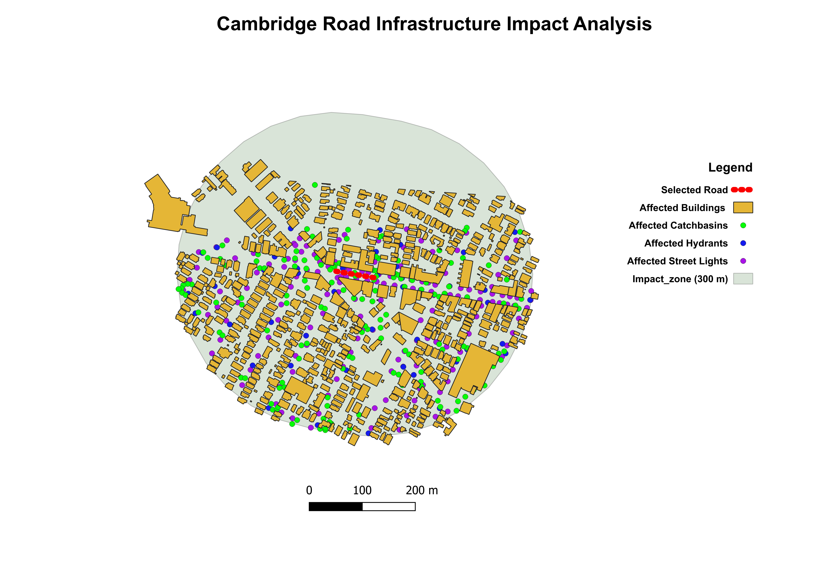

# Smart Urban Infrastructure GIS Platform

A GIS-based decision-support application for analyzing urban infrastructure assets located within a configurable impact distance from a selected road segment.

The project combines **Python, PostgreSQL/PostGIS, Spatial SQL, GeoPandas, QGIS, Streamlit, Folium, and AI-assisted request interpretation** in an end-to-end information system.



## Project Overview

Municipal and infrastructure teams often need to understand which assets may be affected by planned work around a specific road segment.

This project provides an interactive workflow where a user can:

1. Select a road segment directly from a map.
2. Enter a request in natural language, in Hebrew or English.
3. Review the interpreted analysis parameters.
4. Run a spatial impact analysis in PostGIS.
5. View affected infrastructure assets and distances.
6. Generate a business-oriented AI summary based only on verified database results.
7. Save and review previous analysis runs.

The current implementation analyzes:

- Buildings
- Hydrants
- Street lights
- Catch basins

## System Workflow

```text
User
  ↓
Streamlit + Folium Interface
  ↓
Natural-Language Request
  ↓
AI Parameter Extraction
  ↓
Python Validation / Human Review
  ↓
PostgreSQL + PostGIS
  ↓
Spatial Analysis with ST_DWithin
  ↓
Affected Asset Details + Counts
  ↓
History / Reporting
  ↓
AI Business Summary
```

## Key Features

### Interactive Road Selection

The user selects a location directly on an interactive map.

The application finds the nearest road segment in PostGIS and prevents analysis when the selected point is too far from a valid road.

### Natural-Language Analysis Requests

Users can enter requests such as:

```text
Check hydrants and street lights within 250 meters.
```

or in Hebrew.

The AI layer converts the request into structured parameters such as:

```text
distance_m = 250
asset_types = [hydrants, street_lights]
```

The extracted parameters are reviewed and validated before any spatial query is executed.

### Human-in-the-Loop Validation

AI output is never treated as database truth.

For example, if a request does not contain a distance, the system does not invent a default value. The user must define the missing parameter before the analysis can run.

### Spatial Impact Analysis

The actual spatial calculation is performed by PostgreSQL/PostGIS.

`ST_DWithin` is used as the official rule for determining whether an infrastructure asset is located within the configured distance from the selected road geometry.

`ST_Buffer` is used only for impact-zone visualization.

This separation keeps the analytical rule consistent with the business requirement.

### Detailed Asset Results

For each requested infrastructure category, the system can return both aggregate counts and detailed records including identifiers, descriptive attributes, and calculated distance from the selected road.

### Analysis History

Each analysis run is stored in PostgreSQL with:

- Selected road
- Analysis distance
- Requested asset categories
- Asset counts
- Timestamp

Historical runs can be filtered and reopened for detailed review.

The current MVP reconstructs historical asset details using the current infrastructure dataset. An immutable asset-level snapshot table would be a future enhancement for full auditability.

### AI Business Summary

After PostGIS finishes the analysis, the application can generate a concise business summary.

The AI receives only verified results returned by the spatial engine and is instructed not to invent additional values, classifications, or operational conclusions.

## Data Engineering and GIS Processing

The source data comes from municipal GIS datasets for Cambridge, Massachusetts.

The project includes infrastructure layers for roads, buildings, hydrants, street lights, catch basins, and the city boundary.

The original datasets use:

```text
EPSG:2249
Massachusetts Mainland / US survey feet
```

During the ETL process, the data is cleaned and reprojected to:

```text
EPSG:26986
NAD83 / Massachusetts Mainland
Units: meters
```

Using a metric CRS ensures that spatial thresholds such as 150 m or 300 m have a clear and consistent meaning.

The ETL process also includes:

- Schema and attribute inspection
- Geometry validation
- Missing-value analysis
- Internal surrogate IDs
- CRS transformation
- Export to GeoPackage
- Loading into PostgreSQL/PostGIS

## Technology Stack

**Application**
- Python
- Streamlit
- Folium
- streamlit-folium

**Database & Spatial Analysis**
- PostgreSQL
- PostGIS
- Spatial SQL
- SQLAlchemy
- Psycopg

**GIS & Data Processing**
- GeoPandas
- QGIS
- GeoPackage
- Shapefile

**AI Integration**
- OpenAI API
- Structured parameter extraction
- Grounded result summarization

## Project Structure

```text
Smart-Urban-Infrastructure-GIS/
│
├── python/
│   ├── 01-12  Data exploration and preparation
│   ├── 13-19  PostgreSQL/PostGIS loading
│   ├── 20-23  Spatial-analysis development
│   ├── 24_streamlit_app.py
│   ├── spatial_impact_engine.py
│   └── ai_analysis_service.py
│
├── sql/
│   └── 00_database_setup.sql
│
├── maps/
│   ├── cambridge_road_impact_analysis.png
│   └── smart_urban_infrastructure.qgz
│
├── requirements.txt
├── .gitignore
└── README.md
```

## Architecture Decisions

Several design decisions were made to keep the system safe and maintainable:

- AI does not generate arbitrary SQL.
- AI does not have direct database access.
- Spatial calculations are performed by PostGIS.
- User inputs and AI-generated parameters are validated in Python.
- Missing parameters are not silently replaced with invented defaults.
- Spatial relationships are calculated from geometry rather than artificial relational foreign keys.
- Database credentials and API keys are stored locally in environment variables and excluded from Git.

## Running the Project

Install the Python dependencies:

```bash
pip install -r requirements.txt
```

The application also requires:

- PostgreSQL with PostGIS
- The required GIS datasets loaded into the `gis` schema
- Local database configuration
- An OpenAI API key for AI-assisted features

The Streamlit application can then be started with:

```bash
streamlit run python/24_streamlit_app.py
```

Raw and processed GIS datasets are intentionally excluded from the repository because of their size.

## What I Learned

This project provided practical experience with an end-to-end spatial information-system workflow:

```text
GIS Data
→ ETL and Data Quality
→ PostgreSQL/PostGIS
→ Spatial SQL
→ Python Application Logic
→ Interactive Web Interface
→ Reporting and AI Integration
```

It also required translating a business requirement into a spatial-analysis rule, separating application responsibilities, validating user and AI inputs, designing analysis history, and debugging differences between alternative spatial-query approaches.